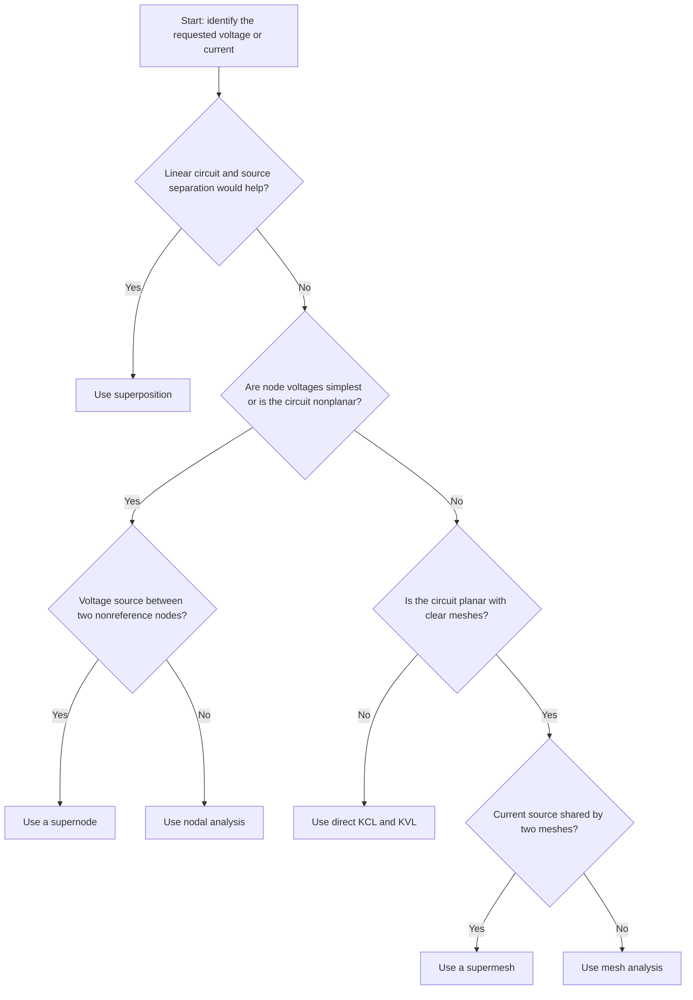
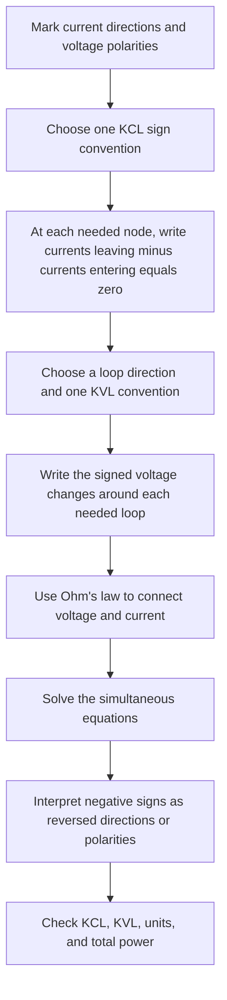
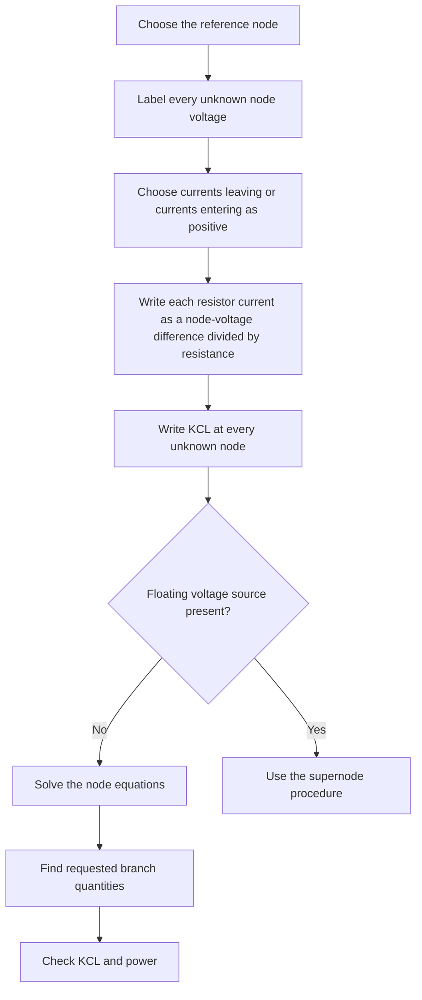
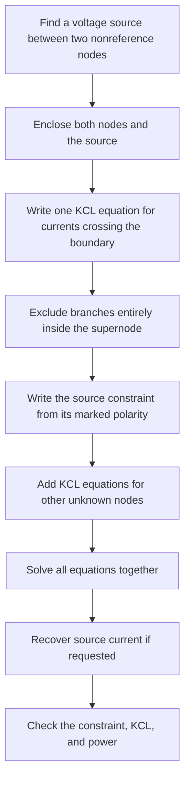
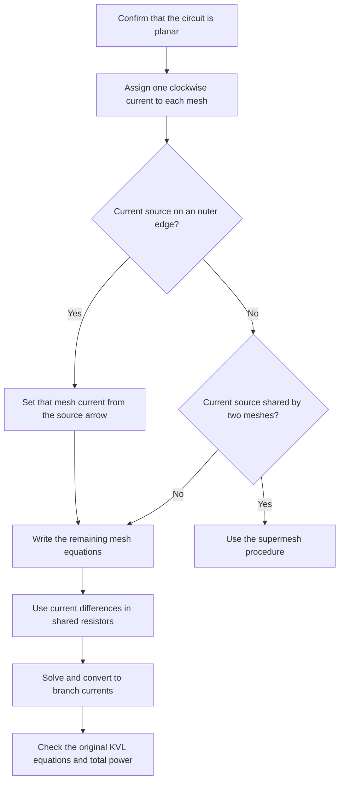
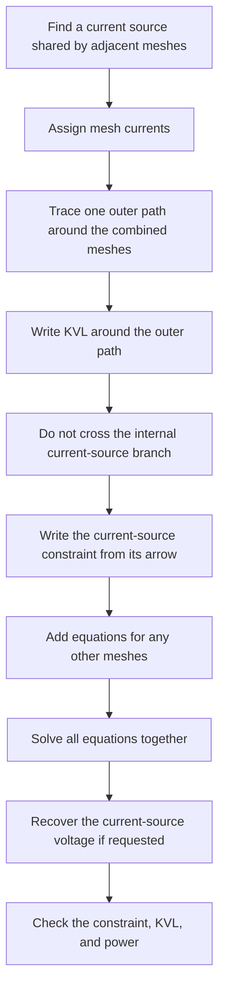
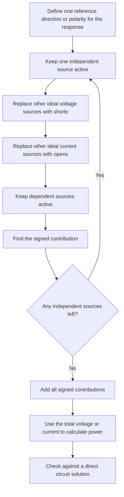
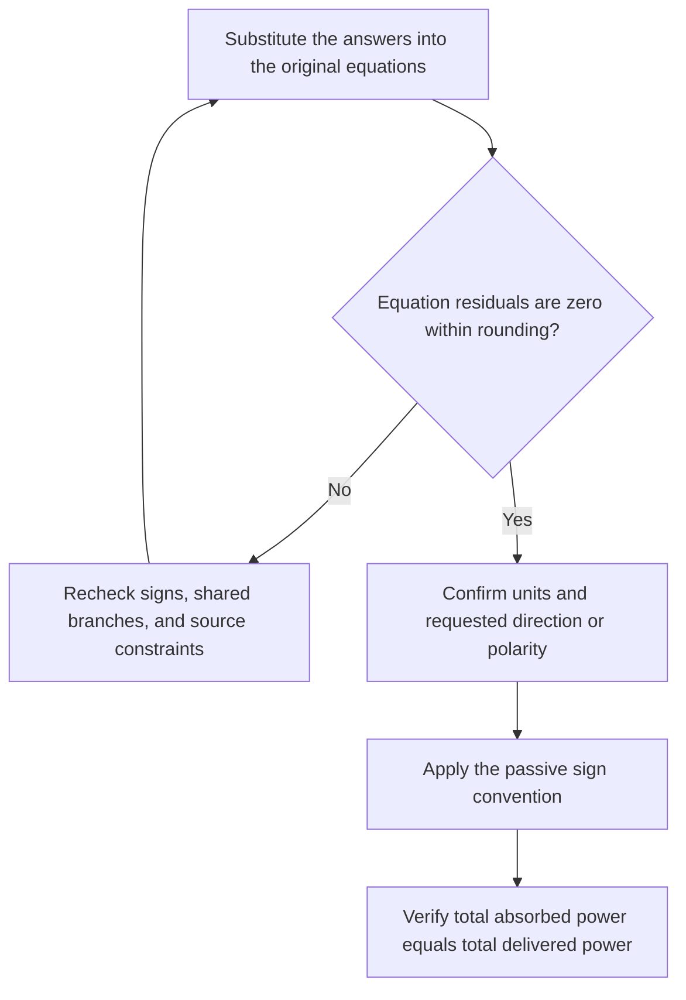

# Circuit Analysis Flowcharts

Use the first chart to choose a method. Then follow the matching procedure.

## Choose a method

## KCL and KVL

For KCL, a branch current from node A to node B is $I_{A\to B}=(V_A-V_B)/R$. For KVL, keep the chosen rise or drop convention for the entire loop.

## Nodal analysis

## Supernode analysis

If the source polarity is positive at A and negative at B, use $V_A-V_B=V_s$.

## Mesh analysis

For a resistor shared by clockwise currents $i_1$ and $i_2$, its drop in mesh 1 is $R(i_1-i_2)$.

## Supermesh analysis

Derive the constraint from the arrow. It can be $i_1-i_2=I_s$ or $i_2-i_1=I_s$.

## Superposition

Do not superpose power. First find the total voltage or current, then use $P=VI$, $P=I^2R$, or $P=V^2/R$.

## Final checks

